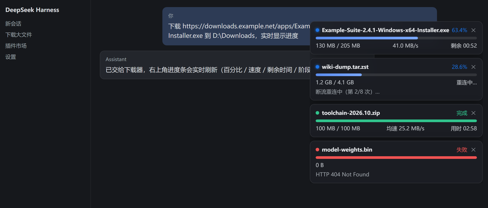

# dsh-download-progress

**DeepSeek Harness 下载进度插件** · 让 AI 下载网络文件时不再黑盒等待：

- 💬 **聊天窗口右上角实时进度条**：百分比、进度条、已下载/总大小、实时速度、**预计剩余时间（ETA）**、当前阶段（探测→连接→下载→断线重连→完成）；下载中可一键取消，结束后卡片停留、可随时手动关闭
- 📏 **下载前预探测**：`dl start` 先取文件大小，按站点历史速度给出**预计总耗时**
- 🔁 **断点续传**：断流 20 秒自动重连续传（最多 8 次）；取消/失败后 `dl resume` 从断点继续
- 🤖 **开箱即用**：安装插件后自动把 `download-progress` 技能装进 `$DSH_HOME/skills/`，会话里说"下载 <URL> 并显示进度"即可触发



> 浅色主题见 [`docs/screenshot-light.png`](docs/screenshot-light.png)。卡片由本插件客户端 `lib/client.js` 真实渲染，数据来自下载 worker。

## 安装

### 从 DSH 插件市场（推荐，收录后可用）

在 DSH 左侧 **插件** 市场搜索 `dsh-download-progress` → 安装 → 重启 DSH。

### 本地安装（开发/测试）

```bash
# 1. 打包
cd dsh-download-progress && npm pack
# 得到 dsh-download-progress-0.3.2.tgz

# 2. 解压到 DSH profile 的 node_modules
mkdir -p ~/.dsh/profiles/desktop/node_modules/dsh-download-progress
tar -xzf dsh-download-progress-0.3.2.tgz -C ~/.dsh/profiles/desktop/node_modules/dsh-download-progress --strip-components=1

# 3. 在 ~/.dsh/profiles/desktop/package.json 里注册（仿照 dsh-purge-community 的写法）
#    dependencies 加:  "dsh-download-progress": "file:<tgz 的绝对路径>"
#    dsh.profile.bundles 加: "dsh-download-progress"

# 4. 重启 DSH
```

## 使用

安装并重启后，在会话里直接说：

> 下载 https://registry.npmmirror.com/-/binary/electron/33.2.0/electron-v33.2.0-win32-x64.zip 到 D:\Downloads，实时显示进度

聊天窗口右上角会出现悬浮进度条（文件名/百分比/速度/剩余时间/阶段），agent 同时在聊天里播报关键节点。所有通过 `dl.mjs` 发起的下载（无论哪个 agent）都会显示在进度条上。

## 工作原理

```
agent（DSH 会话）
  └─ 调用 dl.mjs（技能内脚本，Node ≥18 零依赖）
       ├─ 预探测：HEAD/Range 请求拿文件大小 + 按站点历史速度估算耗时
       ├─ 后台下载：进度写入 ~/.agent-downloads/jobs/<id>/status.json
       └─ 断流自动重连续传、取消/失败可 resume
DSH 运行时（本插件服务端 lib/index.mjs）
  └─ webServer 暴露 /api/dsh-download-progress/list | /cancel（经宿主 connection 鉴权）
DSH Web 客户端（本插件客户端 lib/client.js）
  └─ 自适应轮询任务列表（有卡片 450ms / 空屏 1.5s），在页面右上角渲染悬浮进度条
```

- 插件为标准 cordis 插件：`cordis.patch.yml` 声明插入，`./client` 导出自动进入 Web 客户端，**不改宿主任何文件**，随 DSH 升级无需重新打补丁。
- 只使用 Node 标准库，无任何 npm 运行时依赖；任务数据只存本机，不外传。

## 开发与测试

```bash
npm test              # node --test：本地 HTTP 夹具，不联网、不需要外网
npm run screenshot    # 用真实 client.js 重新生成 docs/screenshot-*.png
npm run pack:check    # 查看打进 tgz 的文件
```

## 更新记录

### 0.3.2 — 开源准备

- 任务根目录改为通过 `--home` 显式传给 worker：WMI 代启的子进程继承的是 WmiPrvSE 的环境，自定义 `AGENT_DL_HOME` 会丢，任务永远停在 `queued/probe`（新增冒烟测试抓到的真实 bug）。
- `status --json` 恒输出合法 JSON（无任务时输出 `[]`），不再混入中文提示。
- 服务端没给 `Content-Disposition` 时，文件名回退到 URL 路径，不再一律 `download-<id>.bin`。
- 卡片：断流重连显示「重连中…」而不是「测速中…」；✕ 支持键盘（role=button / Enter / Space）；减少无意义重绘；`dismissed` 集合加上限。
- 技能安装改为版本一致即跳过，避免每次重启覆盖用户对 SKILL.md 的本地修改。
- 新增 `test/`（4 个用例，覆盖下载/续传/取消/clean）、`scripts/screenshot.mjs` 截图生成器、GitHub Actions CI。

### 0.3.1 — 修复「进度条卡在 3% / 卡片不消失」

- **根因**：Agent 通过一次性命令执行器（`ops_bash` 之类）调用 `dl start`，命令一返回，执行器就回收该命令派生的整棵进程树（Windows 作业对象 / POSIX 进程组），于是 `detached spawn` 出来的下载 worker 也被顺带杀掉 — `status.json` 不再刷新，界面永远停在杀进程那一刻。
- **修复**：Windows 下改由 WMI（`Win32_Process.Create`）代启 worker，父进程变成 `WmiPrvSE`，脱离该作业对象；POSIX 仍用 `setsid`（`detached` 本身）。已实测：worker 在启动它的命令返回后继续跑完整个 178 MB / 100 MB 下载。
- **状态写入**：`rename` 遭遇 `EPERM/EBUSY`（Windows 上读侧同时打开文件）时重试并退化为直接覆盖写，避免某一次写失败导致进度永久冻结。
- **界面**：轮询改为自适应（有卡片 450 ms / 空屏 1.5 s，后台标签页暂停）；客户端按 `updatedAt` 自行判定「已中断」（6 s），不再依赖宿主 60 s 自愈；**终态卡片自动收起**（完成 4 s、失败/取消 12 s，鼠标悬停时暂停）。
- **启动健壮性**：`dl start/resume` 会先建好目标目录，启动失败直接落盘 `failed` 并给出原因，不再留一个永远 `queued` 的僵尸任务。

## 发布到 GitHub / 收录进插件市场

1. `node scripts/set-owner.mjs <你的GitHub用户名>`（替换 package.json/README 里的 `Beership` 并设置 origin），再把目录推到与 package.json 同名的仓库；
2. 发布 Release，上传 `npm pack` 产出的 tgz（文件名需与 `dsh.install.tarball` 一致；版本号变了要同步更新 URL 和版本号）；
3. 在 DSH 插件市场页面点「申请收录入口」提交仓库地址，等待收录后所有用户可直接搜索安装；
4. 每次更新：改版本号 → `npm pack` → 发新 Release → 同步 `dsh.install.tarball` 里的版本号。

## 许可证

MIT
